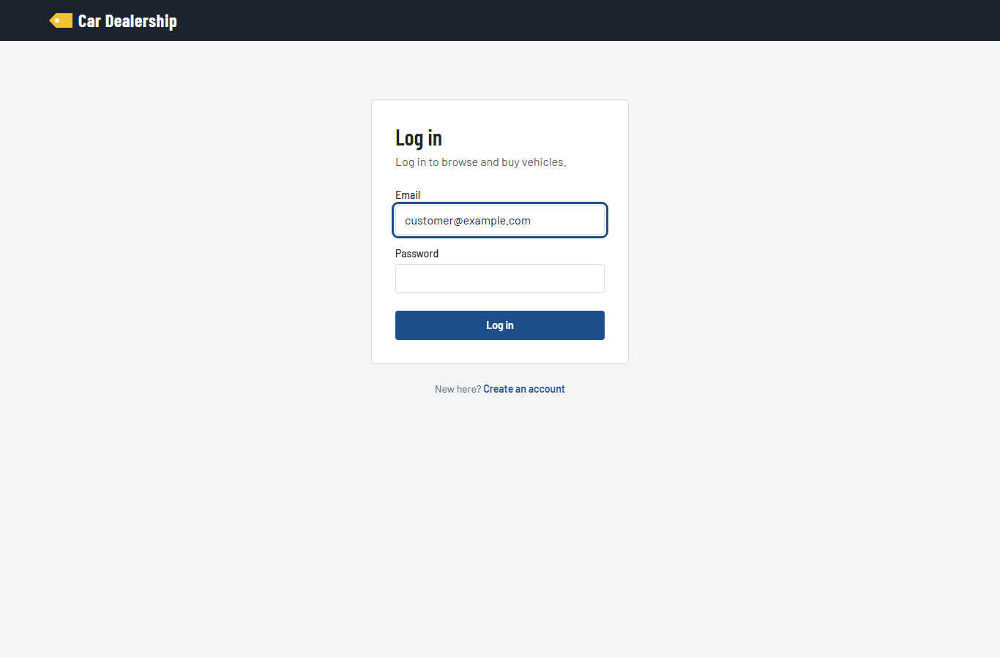
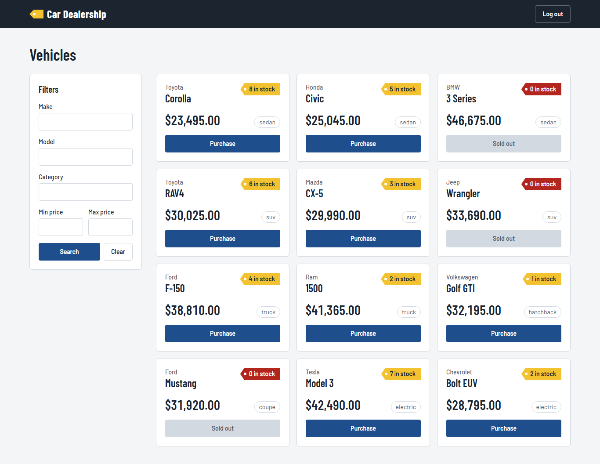
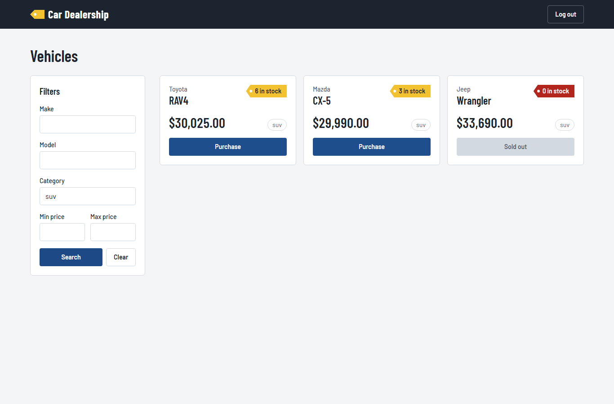
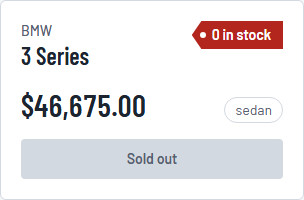
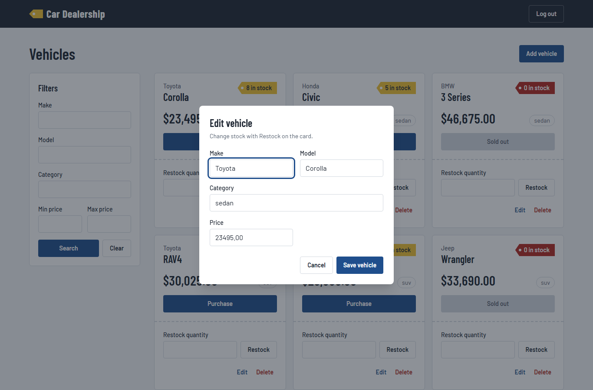
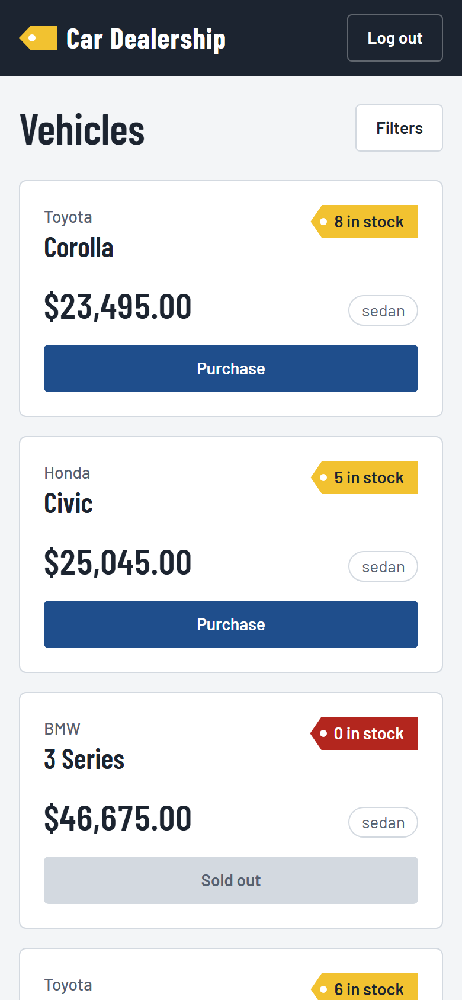

# Car Dealership Inventory

A full-stack inventory system for a car dealership. Users register, sign in, browse, and search the vehicle stock, and buy cars. Admins also add, edit, delete, and restock vehicles. The whole project was built following the principles of Test-Driven Development (TDD), and the red -> green -> refactor steps as separate commits in the git history.

Stack: FastAPI, SQLAlchemy, SQLite, PyJWT, pwdlib, React, TypeScript, Vite, Tailwind CSS, pytest, Vitest + React Testing Library + MSW

## Features

- Register and log in with JWT bearer tokens. Every vehicle and inventory endpoint needs a token.
- Two roles: `user` and `admin`. Only admins can create, update, delete, and restock vehicles. Any signed-in user can list, search, and buy.
- Search by make, model, or category (partial, case-insensitive matches) and by price range (both ends inclusive). Filters combine with AND.
- Purchases can't oversell. Stock never goes below zero, even when purchases happen at the same time.
- Pagination on the vehicle list.
- **Frontend**: a dashboard with filters (drawer on mobile), and the Purchase button is disabled when stock is zero. Admins get modals to add, edit, and delete, plus an inline restock control. It also has loading, empty, and error states, toasts, a confirmation step before purchases, expired-session handling, and a not-found page.

## Architecture

The backend has three layers, and each layer only calls the one below it.

- Routes (`app/routes/`) are kept thin. They parse and validate the request, call one service, and turn the result into an HTTP response. They never touch the database session.
- Services (`app/services/`) hold the business rules. Examples: only admins can delete or restock, stock can never go below zero, emails are compared without regard to case, and a price range must have its minimum no higher than its maximum. When a rule is broken, the service raises a plain domain error such as VehicleNotFound or InsufficientStock, and it never builds an HTTP response.
- Repositories (`app/repositories/`) are the only code that talks to the database. Everything goes through SQLAlchemy, including the atomic stock updates.

The other folders support these layers:

- `app/domain/` holds the errors, the `Role` enum and the search filter, so every layer can use them without depending on FastAPI.
- `exception_handlers.py` has a single table that maps each domain error to an HTTP status (404, 409, 403 and so on). Because of this, no route needs a `try/except`.
- `dependencies.py` sets up the database session, the services, and the `get_current_user` and `require_admin` guards.
- `factory.py` builds the app from a `Settings` object, so tests can give it a temporary database.

The frontend is a React single-page app. It talks to the API only through a small typed client (`src/api/`), which adds the bearer token to each request and turns any error response into an `ApiError`. Login state is kept in an `AuthContext` that’s saved to `localStorage`. `ProtectedRoute` and `GuestRoute` decide which pages a signed-in or signed-out visitor can see. In development, Vite forwards requests to `/api` on to the FastAPI server, so the browser only ever talks to one origin.

## Decisions

| Decision | Why |
| --- | --- |
| Atomic stock decrement: `UPDATE … SET quantity = quantity - :n WHERE id = :id AND quantity >= :n` | A version that read the stock and then wrote it back let 10 buyers in parallel threads take 5 cars. This single statement makes the check and the write happen together. See ADR 0001. Restock uses a similar quantity + :n. |
| Money is Decimal end to end, stored as `Numeric(12, 2)` and sent in JSON as a string with 2 decimal places | Avoids float rounding errors. |
| Tables are created at startup (`create_all`), with no migrations | Keeps a kata-sized project simple. Alembic is listed as a “could have”. |
| Admins are created by a CLI command, never through the API | `register` ignores any role the client sends. |
| Emails are stored lowercase and are unique without regard to case | Prevents duplicate accounts that differ only in letter case. |
| Login returns the same 401 message for an unknown email and a wrong password, and takes the same time for both | Prevents attackers from finding out which emails are registered. |
| The token is kept in `localStorage`, and a 401 on a request that sent a token signs the user out | Simple for an SPA. The trade-off is that a cross-site scripting (XSS) attack could read the token; `httpOnly` cookies would avoid that. |
| Search treats `%` and `_` as literal characters | User input can’t act as SQL LIKE wildcards. |
| Each purchase defaults to a quantity of 1; restock needs an explicit positive quantity | — |
| Updating a vehicle never changes its quantity | Stock changes only through purchase and restock. |

## Setup

Python 3.14+, uv, Node with npm

### Backend

```
cd backend
uv sync
Copy-Item .env.example .env     # then edit JWT_SECRET and the admin credentials
uv run fastapi dev app/main.py
```

### Frontend

```
cd frontend
npm install
npm run dev
```

The Vite dev server forwards requests to `/api` on to `http://localhost:8000`, so start the backend first.

## Environment Variables

| Variable | Default / Notes | Description |
| --- | --- | --- |
| `DATABASE_URL` | `sqlite:///./dev.db` | Any SQLAlchemy URL |
| `JWT_SECRET` | `(required)` | At least 32 characters. Generate one with `python -c "import secrets; print(secrets.token_urlsafe(48))"` |
| `JWT_ALGORITHM` | `HS256` | — |
| `JWT_EXPIRE_MINUTES` | `60` | — |
| `CORS_ORIGINS` | `["http://localhost:5173"]` | A JSON list |
| `ADMIN_EMAIL / ADMIN_PASSWORD` | `—` | Only used by `create-admin` |

## Creating an admin and loading demo data

```
cd backend
uv run python -m app.cli create-admin   # reads ADMIN_EMAIL / ADMIN_PASSWORD
uv run python -m app.cli seed-demo      # 12 vehicles (3 sold out); only seeds an empty inventory
```

You can safely run `create-admin` again. It exits with an error if the email already belongs to a regular user, because it won’t promote an existing user to admin.

## Running tests

```
# backend
cd backend
uv run pytest -q
uv run pytest --cov=app --cov-report=term-missing
uv run ruff check; uv run ruff format --check

# frontend
cd frontend
npm test -- --run
npx vitest run --coverage
npm run lint
```

The tests use a temporary SQLite database for each test and never touch `dev.db`. GitHub Actions runs both suites on each push (`.github/workflows/`).

## Test report

| Suite | Result | Coverage |
| --- | --- | --- |
| Backend (pytest) | 139 passed | 100% statements |
| Frontend (Vitest) | 52 passed | 90.3% statements · 82.8% branches · 95.2% functions |

The full output is in [docs/test-report-backend.txt](docs/test-report-backend.txt) and [docs/test-report-frontend.txt](docs/test-report-frontend.txt).

## Screenshots

### Login



### Dashboard



### Search results



### Sold-out vehicle



### Admin: add or edit a vehicle



### Mobile



## My AI Usage

### Tools

- Claude Code (Opus 5.5)
- Context7 MCP to check current library APIs before writing unfamiliar code. I set it up in `.mcp.json` on day one.
- Built-in skills at specific points: `/security-review`, `/code-review`, and `/frontend-design`

### Setting the Rules First

Before any feature code, I wrote [dev-plan.md](dev-plan.md) with the scope, the main decisions, and the phases. Then I had Claude draft `CLAUDE.md` as a working agreement, following a spec I gave it, and I approved it. The agreement says:

- Strict red -> green -> refactor, one behavior per cycle
- Stop after every step, do not commit without my go-ahead. (I ran the tests after each step to ensure failure points and reasons, correct successes, and successes after refactoring).
- In RED, write only tests, and show that they fail on an assertion rather than an import error.
- Never edit, skip, or delete an existing test to make it pass.
- Keep to the routes -> services -> repositories layering.

### How a Cycle Worked

I worked from my own list of behaviors. For each step I wrote a short prompt.

- **RED**: the RED prompt described the behavior, for example: "Repository test: try_decrement(id, n) returns False and leaves stock unchanged when stock < n. Add a regression test too: file-backed SQLite, stock 5, 10 threads each buying 1 in their own session → exactly 5 succeed, final stock 0."
- **GREEN**: the GREEN prompt named the shape of the fix, for example: "A single UPDATE vehicles SET quantity = quantity - :n WHERE id = :id AND quantity >= :n; check rowcount."
- **REFACTOR**: the REFACTOR prompt named the smell to fix.

### Where I Steered or Corrected it

- RED failures had to be real failures. Several RED tests would have crashed on a missing function instead of failing an assertion. So I had Claude write a placeholder first, such as a get_current_user that returns a fake user, or a no-op create_admin, and only then write the real code in a separate GREEN step.
- I worked out crashes myself. In the invalid-login RED test, the unknown-email case crashed with AttributeError instead of returning 401. I traced the cause to TestClient re-raising server exceptions, and I asked Claude to confirm that the test itself was correct.
- I gave it details it would have missed. For example, app/factory.py must import the models package, or create_all won’t see the users table.
- I decided how to label tests that already passed.
    - When some new validation cases passed straight away, I kept all 7 of them as regression guards.
    - When a test only pinned down existing behaviour (register ignoring a client-supplied "role": "admin"), I had the commit relabelled as TEST, not (RED).
- I asked for trade-offs before choosing. For the config foundation, I asked Claude to explain the options, pros and cons for:
    - where the engine and session factory live
    - whether JWT_SECRET should have a default
    - how to connect CORS_ORIGINS

    I chose: keep the engine on the app, make the secret required with a minimum length of 32, and add CORS later in its own test-first cycle.

- I designed the concurrency fix. I accepted a simple read-then-write purchase on purpose, knowing a later cycle (I5) would replace it. For that cycle, I specified the regression test (10 threads, stock of 5, exactly 5 should succeed) and the single conditional UPDATE. The first version oversold all 10, which proved the test worked. I then had the decision recorded in ADR 0001.

### Reviews and Hardening

- Security review. /security-review found no high or medium issues. I turned three of its lower findings into TDD cycles:
    - login was case-sensitive on email
    - create_admin kept the email’s case
    - create_admin would silently “succeed” when the email belonged to a regular user
- Coverage. I gave Claude the coverage report, which was at 97%, and had it fill the gaps with characterization tests. Each test came with a deliberate-break check, to show the test can actually fail. That took the backend to 100%.
- Code review. /code-review on the backend found 10 issues. I had each fixed in its own RED → GREEN cycle:
    - inconsistent money formatting
    - login timing that revealed which emails are registered
    - a register race that returned 500 instead of 409
    - a demo seed that could stop half-way
    - LIKE wildcards in search not being escaped
    - JWTs not requiring exp and a numeric sub
    - no upper limit on the login password length
    - three code clean-ups

### Frontend:

- Same discipline as the backend. Claude scaffolded it with Context7 checks, then built each feature test-first.
- It stopped and asked when an existing test would have to change:
    - The smoke test would break once / redirected to login.
    - The two purchase tests would need to click a new confirmation dialog.

    I approved the purchase-test change explicitly. The rule against editing existing tests held throughout.

- Visual design. I used /frontend-design for the look (a dealer’s window-sticker style, a filter drawer on mobile, loading skeletons, toasts, and modals that keep keyboard focus inside them). Claude checked the result in a browser at 375 px and 1280 px against a throwaway database, never against dev.db.
- My manual click-through. Clicking through the app myself found six bugs. Five were fixed in RED/GREEN cycles. For that one task, I relaxed two rules: Claude could commit after each step, and it didn’t have to stop for me between steps. Each RED test was staged alone with git apply --cached, so it got its own commit. I deliberately left the sixth issue alone: a saved vehicle stays in the search results even if it no longer matches.